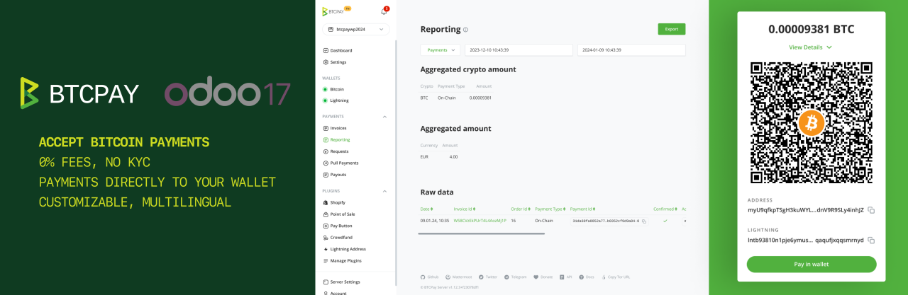

# BTCPay Server payment gateway for Odoo 16 - 20

:::warning
The `20.0` branch uses the **BTCPay Greenfield API** (API key + store id + signed
webhooks). Branches `18.0`/`19.0` use the legacy BitPay API with pairing codes;
`16.0`/`17.0` are end-of-life.
:::

## Accept bitcoin payments on Odoo 16, 17, 18, 19 and 20
This odoo addon allows you to accept bitcoin and Lightning Network (and other cryptocurrency) payments in your Odoo e-commerce store.  

## How to install

Please find the installation instructions here:
- [Odoo 20 documentation (this branch, Greenfield API)](https://github.com/btcpayserver/odoo/blob/20.0/payment_btcpayserver/README.md)
- [Odoo 18 + 19 documentation (legacy BitPay API)](https://github.com/btcpayserver/odoo/blob/19.0/payment_btcpayserver/README.md)
- [Odoo 17 documentation](https://github.com/btcpayserver/odoo/blob/17.0/payment_btcpayserver/README.md)
- [Odoo 16 documentation](https://github.com/btcpayserver/odoo/blob/16.0/payment_btcpayserver/README.md)