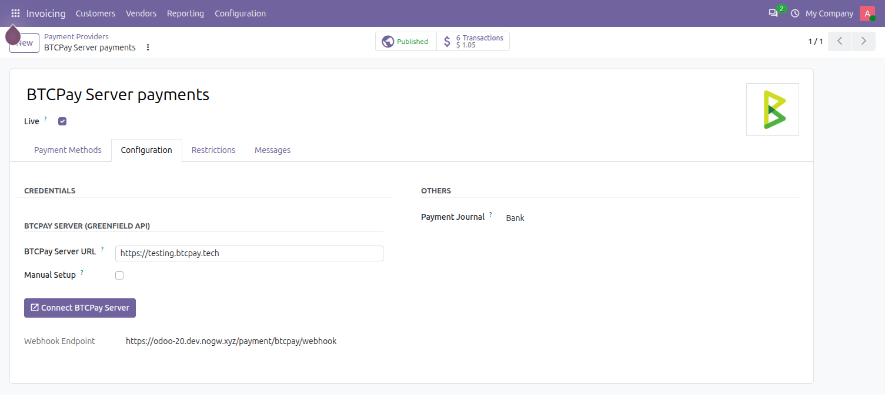
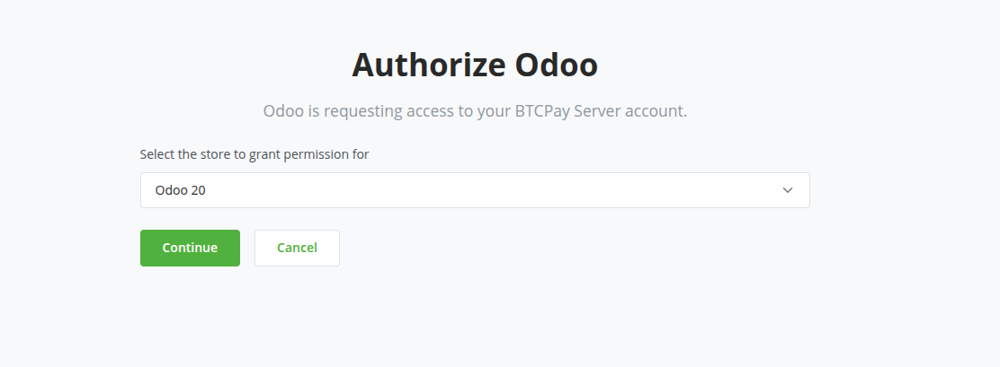
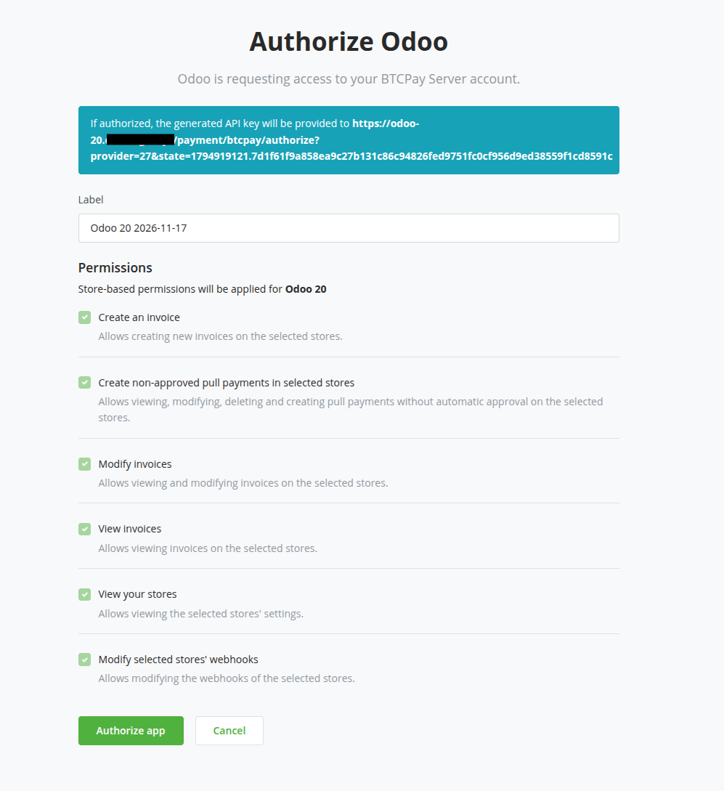
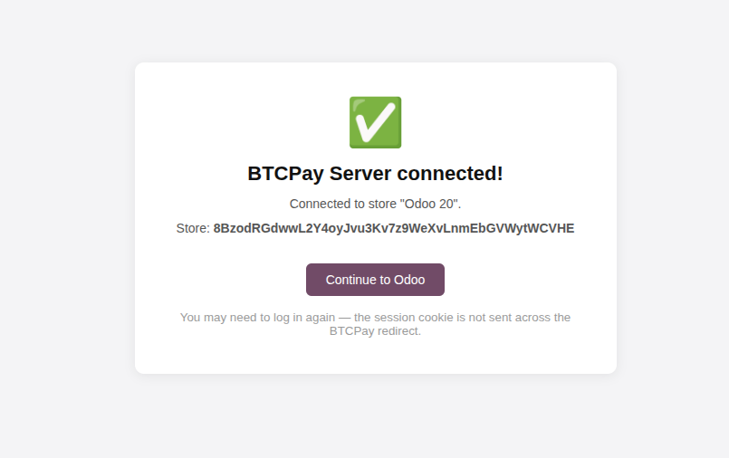
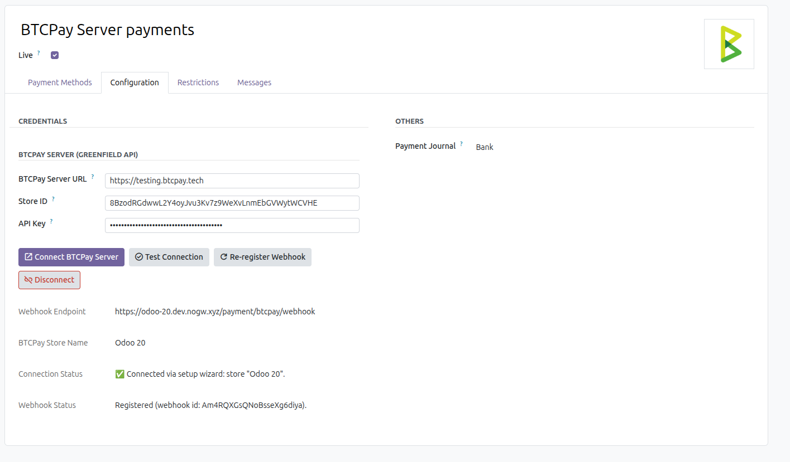
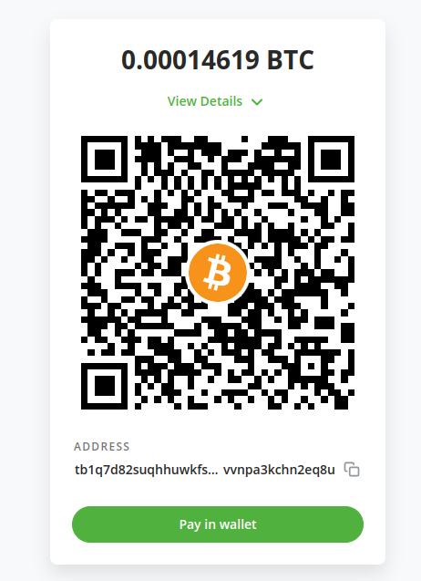
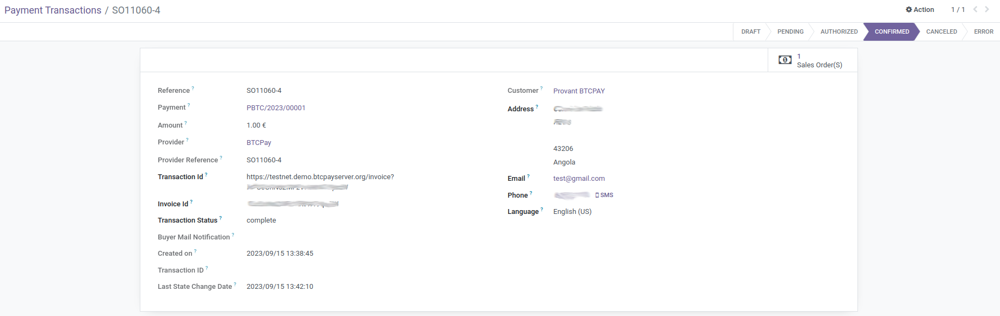

# BTCPay Server payment gateway for Odoo 20

## This is the module to connect Odoo 20 and BTCPay Server (Greenfield API)
This module allows you to accept bitcoin (and other cryptocurrency) payments in your Odoo e-commerce store.  

:::tip
**Using an older Odoo version?** Branches `18.0` and `19.0` are maintained in
maintenance mode and use the legacy BitPay API with pairing codes:
[Odoo 18/19 documentation](https://github.com/btcpayserver/odoo/blob/19.0/payment_btcpayserver/README.md).
Branches `16.0` and `17.0` are end-of-life and no longer maintained.
:::

:::warning
**Upgrading from module version v20.0.1.x (pairing-code setup)?** Versions
v20.0.2.0 and later switch to the BTCPay Greenfield API. The old
pairing/token credentials are not compatible — reconnect the provider once
after updating (see
[Upgrading from the legacy pairing setup](#upgrading-from-the-legacy-pairing-setup)).
Existing transactions keep working; the module can still read invoices
created before the switch.

Version guidance by release:
* **v20.0.1.x** ([v20.0.1.0 release](https://github.com/btcpayserver/odoo/releases/tag/v20.0.1.0))
  still uses the **legacy BitPay API** with pairing codes — same setup as
  Odoo 18/19, no reconnect needed after upgrading from older releases.
* **v20.0.2.x** requires the new **Greenfield setup** (this document).
:::

## Install the module
* Clone our [repository](https://github.com/btcpayserver/odoo) or download the .zip from the [releases page](https://github.com/btcpayserver/odoo/releases)
* Make sure you are on branch `20.0` or downloaded a [release](https://github.com/btcpayserver/odoo/releases) tagged with version v20.x
* Place the `payment_btcpayserver` directory in your Odoo addons directory
* Restart Odoo
* Go to Apps -> Update Apps List
* Remove the "Apps" filter and search for "btcpay"
* Click **Activate** button

## Configure BTCPay as payment provider
* Go to  **Website** -> **Configuration** -> **Payment Providers**
* Search for BTCPay and click on button **Activate**

### Setup wizard (recommended)

The easiest way to connect your store is the built-in setup wizard — you only
need the URL of your BTCPay Server instance:

1. In the BTCPay settings form, tab "Credentials", set the field **BTCPay
   Server URL** to your test or live BTCPay Server URL including https://
   (example: `https://testnet.demo.btcpayserver.org`).

   

2. Make sure the provider is **saved** (the button needs the record id).
3. Click **Connect BTCPay Server** — a new browser tab opens on your BTCPay
   Server asking you to **select the store** the key will be granted for:

   

4. Click **Continue**, review the requested permissions and click
   **Authorize app**. The pre-filled label (e.g. "Odoo 20 2026-11-17") helps
   you identify the key later in your BTCPay account.

   

5. BTCPay generates the API key and sends you back to Odoo. You land on a
   confirmation page showing the connected store:

   

6. Click **Continue to Odoo** (you may need to log in again — the session
   cookie is not sent across the BTCPay redirect). The provider now shows
   the store name, the connection status and the registered webhook:

   

7. Click **Test Connection**: both status fields (connection and webhook)
   should show a green check.

The wizard creates an API key with exactly the permissions the module needs,
bound to the single store you selected:

* `btcpay.store.canviewinvoices`
* `btcpay.store.cancreateinvoice`
* `btcpay.store.canmodifyinvoices`
* `btcpay.store.webhooks.canmodifywebhooks`
* `btcpay.store.canviewstoresettings`
* `btcpay.store.cancreatenonapprovedpullpayments`

It also registers the webhook endpoint on your store automatically — no
manual webhook setup needed.

### Manual setup (alternative)

If you prefer to create the API key by hand:

1. On your BTCPay Server: **Account -> Manage Account -> API Keys** — create
   a key with the six permissions listed above, bound to a single store
   ("selective store").
2. Copy your store id: **Store -> Settings -> General** ("Store ID").
3. In Odoo, enable the **Manual Setup** checkbox in the BTCPay credentials
   block, then paste the **Store ID** and the **API Key**.
4. **Save** — the module registers the webhook on your store automatically
   and stores its secret. The "Webhook Status" field shows the webhook id.
5. Click **Test Connection**: both status fields should show a green check.

On the tab "Configuration":
* Make sure field "Payment Journal" is set to "Bank", otherwise you can click on the dropdown and click on the suggestion "Bank"
* Now you can **save** the settings

Check the payment method is enabled:
* Go to  **Website** -> **Configuration** -> **Payment Methods**
* Make sure "Pay with Bitcoin / Lightning Network" is active

Congrats, all done. Do some testing to be sure all works.

## Upgrading from the legacy pairing setup

Module versions v20.0.2.0 and later replace the legacy BitPay API (pairing
codes, private key, token) with the BTCPay **Greenfield API**. This is a
**breaking change**: old pairing credentials cannot be migrated — reconnect
the provider once:

1. Update the module to v20.0.2.0 or later (Apps -> search "btcpay" ->
   Upgrade). The provider form resets to the wizard flow; the old pairing
   fields are gone.
2. Follow [Setup wizard](#setup-wizard-recommended) above (or the manual
   setup) to create an API key and reconnect your store.
3. The webhook is registered automatically during the wizard.
4. Click **Test Connection** to verify everything.

Notes:

* **Payments on invoices created before the switch:** the old legacy IPN
  endpoint no longer exists in v20.0.2.x, so BTCPay's legacy notifications
  for those invoices will fail. As long as the customer stays on the
  BTCPay checkout page, the redirect back to Odoo still resolves the
  payment (the module fetches the invoice through the Greenfield API and
  processes it). Payments that settle *after* the customer left the page
  are only picked up once the new Greenfield webhook is registered (which
  happens automatically during the wizard) — BTCPay redelivers pending
  webhook events for a while, but to be safe check open transactions after
  upgrading.
* **Manual connections need a click too**: if you connected the provider
  with the old pairing flow, the credentials are discarded on upgrade — run
  the wizard again.

## Provider maintenance
* **Test Connection** verifies the API key, its permissions and store
  scoping, and the webhook at once; shows the BTCPay store name.
* **Re-register Webhook** replaces the registered webhook (e.g. after moving
  your store to a new domain). The old webhook is deleted when possible.
* **Disconnect** resets the setup completely: the webhook is deleted on the
  BTCPay store (when possible) and all credentials are cleared.

## Transaction BTCPay Details
In transaction object, you will find more technical information about this method of payment:
* Transaction Id: link to the BTCPay invoice
* Invoice Id: the id of the BTCPay invoice
* Transaction Status: invoice status, including edge cases like `Expired/PaidPartial` (payment arrived after expiry) or `Settled/PaidOver` (customer overpaid) — these cases are flagged for manual review and never auto-confirm an order

## Troubleshooting
### The order and transaction status does not get updated to "paid"
If the BTCPay connection generally works, like redirect to BTCPay checkout page (QR-code) then check your odoo logs and make sure PDF generation generally works. If there are errors mentioning wkhtmltopdf then you need to install `wkhtmltopdf` on your server.

### Webhooks do not arrive (status stays draft after payment)
The webhook endpoint must be reachable by your BTCPay server over public **https** —
without redirects (a http→https redirect makes webhook clients re-send as GET, which
is rejected) and without changing the request body. Check "Webhook Status" on the
provider form, use "Test Connection", and re-deliver events from the BTCPay invoice
page ("Redeliver" link) while watching the Odoo log for `BTCPay: webhook` lines.

### Login page appears after the BTCPay authorization
That is expected: the session cookie is not sent across the cross-site
redirect from BTCPay. Log in again — the connected provider form is opened
directly (or use the "Continue to Odoo" button on the confirmation page).
