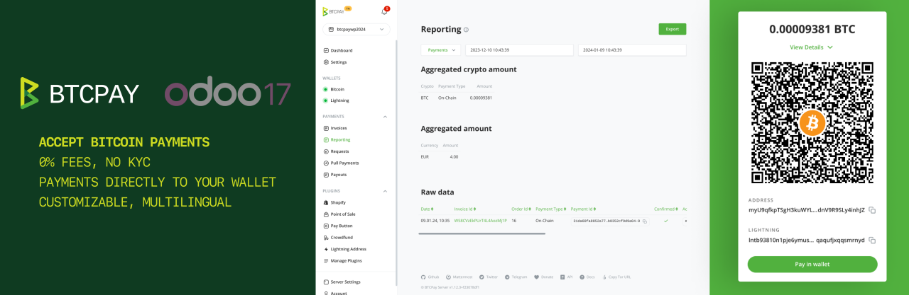
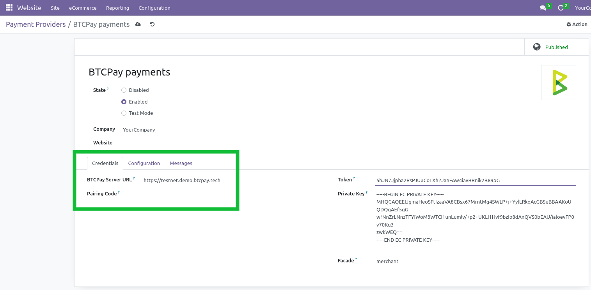

# BTCPay Server payment gateway for Odoo 20

## This is the module to connect Odoo 20 and BTCPay Server (Greenfield API)
This module allows you to accept bitcoin (and other cryptocurrency) payments in your Odoo e-commerce store.  

:::tip
**Using an older Odoo version?** Branches `18.0` and `19.0` are maintained in
maintenance mode and use the legacy BitPay API with pairing codes:
[Odoo 18/19 documentation](https://github.com/btcpayserver/odoo/blob/19.0/payment_btcpayserver/README.md).
Branches `16.0` and `17.0` are end-of-life and no longer maintained.
:::

:::warning
**Upgrading from module version 1.x (pairing-code setup)?** Version 2.0
switches to the BTCPay Greenfield API. The old pairing/token credentials are
not compatible — reconnect the provider once after updating (API key + store
id, see below). Existing transactions keep working; the module can still read
invoices created before the switch.
:::

## Install the module
* Clone our [repository](https://github.com/btcpayserver/odoo) or download the .zip from the [releases page](https://github.com/btcpayserver/odoo/releases)
* Make sure you are on branch `20.0` or downloaded a [release](https://github.com/btcpayserver/odoo/releases) tagged with version v20.x
* Place the `payment_btcpayserver` directory in your Odoo addons directory
* Restart Odoo
* Go to Apps -> Update Apps List
* Remove the "Apps" filter and search for "btcpay"
* Click **Activate** button

## Configure BTCPay as payment provider
* Go to  **Website** -> **Configuration** -> **Payment Providers**
* Search for BTCPay and click on button **Activate**

In the BTCPay settings form, tab "Credentials":
* Set field "State" to enabled
* Set field "BTCPay Server URL" as test or live URL including https://. Example URL: https://testnet.demo.btcpayserver.org
* Create an API key on your BTCPay Server scoped to one store:
  * Go to: Account -> Manage Account -> API Keys
  * Create a key with these permissions: `btcpay.store.canviewinvoices`, `btcpay.store.cancreateinvoice`, `btcpay.store.canmodifyinvoices`, `btcpay.store.webhooks.canmodifywebhooks`, `btcpay.store.canviewstoresettings`, `btcpay.store.cancreatenonapprovedpullpayments`
  * Make sure the key is bound to a single store ("selective store" / bound store)
* Copy your store id: Store -> Settings -> General ("Store ID")
* Back in Odoo: paste the **Store ID** and the **API Key**
* **Save** — the module registers a webhook on the store automatically (the
  "Webhook Status" field shows the registered endpoint). Alternatively create
  the webhook manually in BTCPay (Store -> Settings -> Webhooks, point it to
  `<your-odoo>/payment/btcpay/webhook`, all invoice events) and paste its
  secret into "Webhook Secret".
* Click **Test Connection**: both status fields should show a green check
  (connection, store name and webhook are verified against your BTCPay server).

On the tab "Configuration":
* Make sure field "Payment Journal" is set to "Bank", otherwise you can click the dropdown and click on the suggestion "Bank"
* Now you can **save** the settings

Check the payment method is enabled:
* Go to  **Website** -> **Configuration** -> **Payment Methods**
* Make sure "Pay with Bitcoin / Lightning Network" is active

Congrats, all done. Do some testing to be sure all works.

## Provider maintenance
* **Test Connection** verifies the API key, the store id and the webhook at once and shows the BTCPay store name.
* **Re-register Webhook** replaces the registered webhook (e.g. after moving your store to a new domain). The old webhook is deleted when possible.
* **Disconnect** resets the setup completely: the webhook is deleted on the BTCPay store (when possible) and all credentials are cleared.

## How does the payment page look?

During the checkout the customers will have the option to select the payment method "Pay with Bitcoin / Lightning Network". After selecting they will be redirected to the BTCPay checkout page as shown below.

## Transaction BTCPay Details
In transaction object, you will find more technical information about this method of payment:
* Transaction Id: link to the BTCPay invoice
* Invoice Id: the id of the BTCPay invoice
* Transaction Status: invoice status, including edge cases like `Expired/PaidPartial` (payment arrived after expiry) or `Settled/PaidOver` (customer overpaid) — these cases are flagged for manual review and never auto-confirm an order

## Troubleshooting
### The order and transaction status does not get updated to "paid"
If the BTCPay connection generally works, like redirect to BTCPay checkout page (QR-code) then check your odoo logs and make sure PDF generation generally works. If there are errors mentioning wkhtmltopdf then you need to install `wkhtmltopdf` on your server.

### Webhooks do not arrive (status stays draft after payment)
The webhook endpoint must be reachable by your BTCPay server over public **https** —
without redirects (a http→https redirect makes webhook clients re-send as GET, which
is rejected) and without changing the request body. Check "Webhook Status" on the
provider form, use "Test Connection", and re-deliver events from the BTCPay invoice
page ("Redeliver" link) while watching the Odoo log for `BTCPay: webhook` lines.
